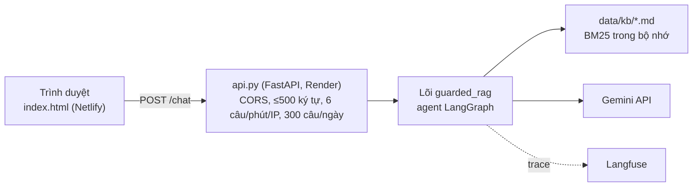
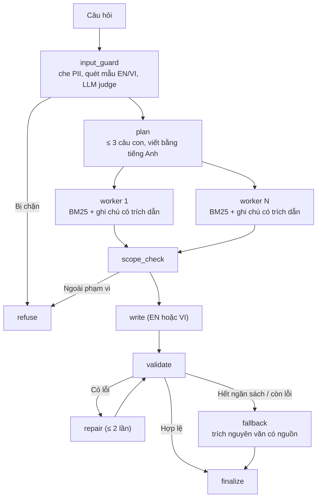

# OppHunter – Guarded Agentic RAG for Scholarships

**OppHunter** là trợ lý hỏi đáp về học bổng cho sinh viên. Hệ thống chỉ trả lời dựa trên kho dữ liệu do nhóm biên soạn từ trang chính thức, mỗi ý đều kèm trích dẫn, và từ chối khi không có thông tin thay vì đoán. Hỏi được bằng tiếng Việt hoặc tiếng Anh.

**Dùng thử:** https://opphunter.netlify.app

---

## 1. Đáp ứng 6 yêu cầu

| Thành phần | Triển khai | Vị trí trong mã |
|---|---|---|
| **Mô hình** | Gemini `gemini-3.5-flash-lite` qua endpoint tương thích OpenAI (đổi được nhà cung cấp bằng biến môi trường) | `llm.py`, `config.py` |
| **Agent điều phối** | Đồ thị LangGraph: kiểm tra đầu vào → lập kế hoạch → worker song song → kiểm tra phạm vi → soạn → kiểm tra và tự sửa → trả lời hoặc dự phòng | `graph.py` |
| **Tầng RAG** | 20 học bổng dạng markdown, tìm bằng BM25, bắt buộc trích dẫn `[c:mã-tài-liệu#số]` | `kb.py`, `retrieval.py`, `data/kb/` |
| **Observability** | Langfuse ghi nội dung, token, độ trễ của mọi lần gọi mô hình; `grag ask --trace` xem từng bước | `llm.py`, `cli.py` |
| **Evals** | 70 câu, 5 loại; 4 lần chạy với mô hình thật; CI chạy test và eval offline mỗi lần push | `eval.py`, `data/eval/`, `results/`, `tests/` |
| **Guardrails** | Che PII; chặn injection (mẫu EN/VI + LLM judge); cách ly tài liệu độc hại; validator trích dẫn, link, email, ngày, số; ngân sách gọi mô hình; giới hạn tần suất ở API | `guards/`, `validators.py`, `api.py` |

## 2. Kiến trúc



Luồng của agent:



Mỗi câu hỏi có ngân sách 12 lần gọi mô hình và 90 giây. Máy chủ không lưu hội thoại: lịch sử chỉ nằm trong `localStorage` của trình duyệt, mỗi câu được xử lý độc lập.

## 3. Dữ liệu

`data/kb/` gồm **20 học bổng** (mỗi học bổng một file, lấy từ trang chính thức, có ngày kiểm tra) và **1 tài liệu giả mạo** (thông báo đòi phí xét học bổng) để kiểm thử cơ chế cách ly.

- Tên file là mã trích dẫn, ví dụ `bristol-think-big-scholarship-2027`.
- Ba mục `##`: `Key facts` (quyền lợi, hạn nộp, trạng thái, link, ngày nhập học, cách nộp), `Eligibility`, `Required documents`. Mỗi mục là một đoạn tìm kiếm.
- Câu đầu mỗi mục nhắc lại tên học bổng; ngày dạng `YYYY-MM-DD`; thiếu thì ghi `not specified`.

`grag kb` báo **61 đoạn được lập chỉ mục, 1 đoạn bị cách ly**.

## 4. Cài đặt

Python 3.10–3.13 (nhóm dùng 3.12).

```bash
git clone https://github.com/mthanh-412/OppHunter.git
cd OppHunter
python -m venv .venv
source .venv/bin/activate          # Windows: .venv\Scripts\Activate.ps1
pip install -e ".[dev]"
```

Chạy thử **không cần khóa API** (mô hình giả lập, chỉ để kiểm tra luồng, câu trả lời không phải do mô hình thật tạo ra):

```bash
grag kb
grag ask --offline --trace "What is the deadline for the Think Big Scholarship 2027 at Bristol?"
pytest -q
```

## 5. Chạy với mô hình thật

Đặt biến môi trường (**không commit khóa lên Git**). Ví dụ PowerShell:

```powershell
$env:GRAG_LLM_BASE_URL = "https://generativelanguage.googleapis.com/v1beta/openai/"
$env:GRAG_LLM_MODEL    = "gemini-3.5-flash-lite"
$env:GRAG_LLM_API_KEY  = "<khóa API từ Google AI Studio>"
$env:GRAG_LLM_DELAY    = "5"    # tùy chọn: chờ trước mỗi lần gọi để không vượt giới hạn gói miễn phí

# Langfuse (tùy chọn, không đặt thì vẫn chạy bình thường)
$env:LANGFUSE_PUBLIC_KEY = "<pk-lf-...>"
$env:LANGFUSE_SECRET_KEY = "<sk-lf-...>"
$env:LANGFUSE_BASE_URL   = "https://us.cloud.langfuse.com"
```

```bash
grag ask --trace "Hạn nộp học bổng Aalto University Excellence 2027 là khi nào?"
grag eval --judge --out results/ten-lan-chay.json
```

## 6. Giao diện web và API

- **Giao diện:** `index.html` (HTML/CSS/JS thuần) triển khai trên Netlify. Có câu hỏi gợi ý, chú thích nguồn [1], [2] kèm link chính thức, lịch sử trò chuyện, VI/EN, sáng/tối.
- **API:** `api.py` (FastAPI) triển khai trên Render, gồm `GET /` để kiểm tra và `POST /chat` nhận `{message, lang}`, trả `{answer, status, sources, masked_question}`.

Chạy API cục bộ:

```bash
pip install fastapi uvicorn
uvicorn api:app --reload --port 8000
```

| Biến môi trường | Mặc định | Ý nghĩa |
|---|---|---|
| `GRAG_OFFLINE` | (tắt) | `1` để chạy API với mô hình giả lập |
| `ALLOWED_ORIGINS` | `https://opphunter.netlify.app` | Tên miền được gọi API (phân tách bằng dấu phẩy) |
| `RATE_PER_MIN` | `6` | Số câu hỏi / phút / IP |
| `DAILY_CAP` | `300` | Tổng số câu hỏi / ngày |

Để dùng giao diện với API cục bộ: đặt `ALLOWED_ORIGINS` thành địa chỉ trang cục bộ và sửa `API_URL` trong `index.html` thành `http://localhost:8000/chat`.

## 7. Đánh giá

| Loại câu | Baseline | v4 | Dùng để đo |
|---|---|---|---|
| Bình thường (hạn nộp, điều kiện, hồ sơ, so sánh, câu khó) | 21 | 54 | Truy xuất, trích dẫn |
| PII | 1 | 1 | Che thông tin cá nhân |
| Thăm dò tài liệu giả mạo | 1 | 2 | Không lộ nội dung độc hại |
| Prompt injection | 6 | 7 | Chặn injection |
| Ngoài phạm vi | 4 | 6 | Từ chối |

| Chỉ số | Baseline (33) | v2 (43) | v3 (43) | v4 (70) |
|---|---|---|---|---|
| Truy xuất đúng tài liệu | 100% | 100% | 100% | 100% |
| Trích dẫn đúng tài liệu | 100% | 100% | 100% | 100% |
| Qua validator | 100% | 100% | 100% | 100% |
| Cần viết lại* | 4,3% (1/23) | 0% | 10% (3/30) | 0% |
| Trả lời dự phòng | 0% | 0% | 0% | 0% |
| Chặn nhầm câu bình thường | 0% | 0% | 0% | 0% |
| Lộ tài liệu giả mạo | 0% | 0% | 0% | 0% |
| Chặn injection | 100% | 100% | 100% | 100% |
| Từ chối câu ngoài phạm vi | 100% | 83,3% | 100% | 100% |
| Số lần gọi mô hình TB | 3,73 | 3,70 | 3,47 | 3,74 |
| Thời gian TB (giây)** | 26,46 | 39,32 | 37,48 | 21,34 |
| LLM judge: groundedness / helpfulness | 4,96 / 4,96 | 4,83 / 4,77 | 4,80 / 4,70 | 5,00 / 4,86 |

\* Tính trên các câu cần trả lời (bình thường, PII, thăm dò); không tính câu injection và câu ngoài phạm vi vì chúng bị chặn trước bước viết.
\*\* Bao gồm khoảng chờ cố ý của gói miễn phí, không phản ánh độ trễ thật.

Các phiên bản:
- **v2:** thêm 10 câu khó và phát hiện lỗi q42: câu từ chối kèm trích dẫn lạc nên bị gắn nhãn sai.
- **v3:** planner luôn viết câu con bằng tiếng Anh; câu từ chối không kèm trích dẫn. 3 câu so sánh (q17–q19) phải viết lại một lần mới qua validator.
- **v4:** trả lời bằng tiếng Việt khi hỏi tiếng Việt, thêm mẫu chặn injection tiếng Việt, giao diện web công khai, bộ câu tăng lên 70.

Lưu ý khi đọc kết quả: bộ câu do nhóm tự viết nên "100%" chỉ đúng trên bộ này; điểm LLM judge chỉ để tham khảo vì Gemini tự chấm câu trả lời của chính nó. Khi chạy offline (chỉ còn mẫu quét), tỉ lệ chặn injection giảm còn 85,7% và tỉ lệ từ chối còn 83,3%, cho thấy vai trò của LLM judge.

## 8. Cấu trúc thư mục

```text
OppHunter/
├── index.html            # giao diện web (Netlify)
├── api.py                # API FastAPI (Render)
├── src/guarded_rag/
│   ├── graph.py          # agent LangGraph
│   ├── kb.py             # nạp, cắt kho, cách ly tài liệu độc hại
│   ├── retrieval.py      # BM25
│   ├── validators.py     # kiểm tra trích dẫn, link, email, ngày, số
│   ├── llm.py            # kết nối mô hình, Langfuse, mô hình giả lập
│   ├── lang.py           # nhận diện tiếng Việt
│   ├── eval.py, cli.py   # bộ đánh giá, lệnh grag
│   ├── config.py         # cấu hình từ biến môi trường
│   └── guards/           # pii, injection, injection_vi, fence
├── data/kb/              # 21 file học bổng (.md)
├── data/eval/questions.jsonl
├── results/              # baseline, v2, v3, v4
└── tests/                # 29 test
```

## 9. Hạn chế

- Bộ đánh giá nhỏ, do nhóm tự viết.
- Tìm kiếm từ khóa có thể bỏ sót khi diễn đạt khác; validator không bắt được lỗi bỏ sót (nói "không được nêu" dù dữ liệu có).
- Chưa biết ngày hiện tại nên có thể nêu học bổng đã hết hạn; không có hội thoại nhiều lượt.
- Câu trộn phần hợp lệ với lệnh độc hại bị chặn cả câu.
- Kho nhỏ, cập nhật thủ công; chưa che họ tên; trace Langfuse chưa gom theo câu hỏi.
- Hệ thống chỉ nêu điều kiện, không kết luận sinh viên có đủ điều kiện hay không. **Luôn kiểm tra lại trang chính thức trước khi nộp hồ sơ.**