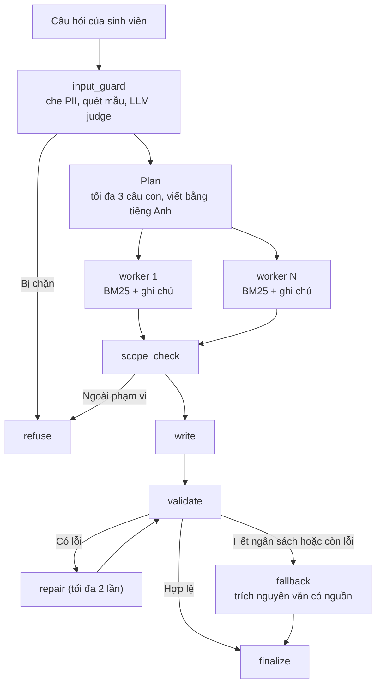

# OppHunter – Guarded Agentic RAG for Scholarships

**OppHunter** là trợ lý hỏi đáp về học bổng cho sinh viên. Hệ thống chỉ trả lời dựa trên kho dữ liệu do nhóm biên soạn từ trang chính thức, mỗi ý đều kèm trích dẫn, và từ chối khi không có thông tin thay vì đoán.

---

## 1. Đáp ứng 6 yêu cầu

| Thành phần | Triển khai | Vị trí trong mã |
|---|---|---|
| **Mô hình** | Gemini qua endpoint tương thích OpenAI (đổi được sang OpenAI, Ollama, vLLM, LiteLLM bằng biến môi trường) | `src/guarded_rag/llm.py`, `config.py` |
| **Agent điều phối** | Đồ thị LangGraph: kiểm tra đầu vào → lập kế hoạch → worker song song → kiểm tra phạm vi → soạn câu trả lời → kiểm tra và tự sửa → trả lời hoặc dự phòng | `src/guarded_rag/graph.py` |
| **Tầng RAG** | Kho tri thức là các file markdown, tìm bằng BM25, câu trả lời bắt buộc có trích dẫn `[c:mã-tài-liệu#số]` | `kb.py`, `retrieval.py`, `data/kb/` |
| **Observability** | Langfuse: ghi nội dung, token, độ trễ của mọi lần gọi mô hình | `llm.py` |
| **Evals** | `grag eval`: 43 câu hỏi, chỉ số truy xuất, trích dẫn, chặn injection, từ chối ngoài phạm vi, lộ tài liệu giả mạo; có LLM judge tùy chọn | `eval.py`, `data/eval/questions.jsonl`, `results/` |
| **Guardrails** | Che PII; chặn prompt injection (quét mẫu + LLM judge); cách ly tài liệu độc hại; validator trích dẫn, link, email, ngày và con số; ngân sách và trả lời dự phòng | `guards/`, `validators.py`, `graph.py`, `kb.py` |

## 2. Kiến trúc và luồng xử lý



1. **input_guard:** che email, số điện thoại; quét mẫu injection; LLM judge kiểm tra thêm.
2. **plan:** tách câu hỏi nhiều chủ đề thành tối đa 3 câu con, viết bằng tiếng Anh (nhờ đó câu hỏi tiếng Việt vẫn tìm được trong kho tiếng Anh).
3. **worker:** tìm song song bằng BM25 và rút ghi chú có trích dẫn.
4. **scope_check:** độ phủ từ khóa thấp thì từ chối là ngoài phạm vi.
5. **write → validate → repair:** câu trả lời chỉ dựa vào ghi chú; validator kiểm tra trích dẫn, link, email, ngày và số có trong nguồn; lỗi thì viết lại tối đa 2 lần.
6. **fallback:** hết ngân sách hoặc vẫn còn lỗi thì trả các ghi chú trích nguyên văn, luôn có nguồn.

## 3. Dữ liệu

Kho dữ liệu nằm trong `data/kb/`: khoảng **[ĐIỀN: số học bổng]** học bổng, mỗi học bổng một file markdown, lấy từ trang chính thức của đơn vị cấp và có ngày kiểm tra. Kho có thêm 1 tài liệu giả mạo (thông báo đòi nộp phí xét học bổng qua email lạ) để kiểm thử cơ chế cách ly.

Quy ước mỗi file:
- Tên file là mã tài liệu dùng trong trích dẫn (ví dụ `bristol-think-big-scholarship-2027`).
- Ba mục `##`: `Key facts` (quyền lợi, hạn nộp, trạng thái, link, ngày nhập học, cách nộp), `Eligibility`, `Required documents`. Mỗi mục `##` là một đoạn tìm kiếm độc lập.
- Ngày theo dạng `YYYY-MM-DD`, kèm `Last verified`. Thông tin thiếu thì ghi `not specified`, không đoán.
- Tên học bổng được nhắc lại ở câu đầu của mỗi mục để tìm kiếm trúng.

Ví dụ minh họa định dạng (dữ liệu hư cấu):

```markdown
# Example Global Scholarship

## Key facts
Example Global Scholarship is a fully funded master's scholarship from Example Foundation. Level: master's. Application deadline: 2027-01-31. Status: open. Last verified: 2026-11-16.
Official page:
https://example.org/scholarship
```

Khi chạy `grag kb`, hệ thống báo số đoạn được lập chỉ mục và đúng 1 đoạn bị cách ly (tài liệu giả mạo).

## 4. Cài đặt

Yêu cầu: Python 3.10–3.13 (nhóm dùng 3.12). Một số thư viện chưa có bản cài sẵn cho các bản Python quá mới.

**Windows (PowerShell)**

```powershell
git clone https://github.com/mthanh-412/OppHunter.git
cd OppHunter
py -3.12 -m venv .venv
.venv\Scripts\Activate.ps1
pip install -e ".[dev,ui]"
```

**macOS / Linux**

```bash
git clone https://github.com/mthanh-412/OppHunter.git
cd OppHunter
python3 -m venv .venv
source .venv/bin/activate
pip install -e ".[dev,ui]"
```

Phần `ui` (Streamlit) chỉ cần cho giao diện web ở mục 7; chạy dòng lệnh thì dùng `".[dev]"` là đủ.

## 5. Chạy thử không cần khóa API

Chế độ `--offline` dùng một mô hình giả lập theo kịch bản, chỉ để kiểm tra toàn bộ luồng chạy được. Câu trả lời ở chế độ này **không** phải do mô hình thật tạo ra.

```bash
grag kb                       # nạp kho dữ liệu, báo số đoạn và đoạn bị cách ly
grag ask --offline "What is the deadline for the Think Big Scholarship 2027 at Bristol?"
pytest -q                     # chạy bộ test
```

## 6. Chạy với mô hình thật

Cấu hình bằng biến môi trường (**không ghi khóa vào mã và không commit khóa lên Git**). Ví dụ với Gemini trên PowerShell:

```powershell
$env:GRAG_LLM_BASE_URL = "https://generativelanguage.googleapis.com/v1beta/openai/"
$env:GRAG_LLM_MODEL    = "<tên model>"
$env:GRAG_LLM_API_KEY  = "<khóa API của bạn>"
$env:GRAG_LLM_DELAY    = "5"    # giây chờ trước mỗi lần gọi, tránh vượt giới hạn tốc độ của gói miễn phí
```

Nhóm đã chạy đánh giá với model **[ĐIỀN: tên model đã dùng]** trên gói miễn phí.

Hỏi một câu và xem các bước đã đi qua:

```bash
grag ask --trace "What is the application deadline for the Aalto University Excellence Scholarship 2027?"
```

Câu hỏi tiếng Việt cũng được hỗ trợ ở mức hạn chế (planner dịch sang tiếng Anh; câu trả lời bằng tiếng Anh).

### Observability với Langfuse (tùy chọn)

Đặt ba biến sau, hệ thống tự gửi trace cho Langfuse; không đặt thì chạy bình thường:

```powershell
$env:LANGFUSE_PUBLIC_KEY = "<pk-lf-...>"
$env:LANGFUSE_SECRET_KEY = "<sk-lf-...>"
$env:LANGFUSE_BASE_URL   = "https://cloud.langfuse.com"   # hoặc https://us.cloud.langfuse.com
```

Mỗi lần gọi mô hình hiện thành một trace riêng (judge_injection, plan, notes, write). Email thật không xuất hiện trong trace vì đã được che trước khi gửi mô hình.

## 7. Giao diện web (chạy cục bộ)

Giao diện cơ bản bằng Streamlit, gọi trực tiếp hàm `answer()` của lõi (file `app.py`).

```bash
streamlit run app.py --server.address localhost
```

Mở `http://localhost:8501`. Giao diện hiển thị câu trả lời, trạng thái (có trả lời, dự phòng, bị chặn, ngoài phạm vi), nguồn trích dẫn và các bước xử lý. Nếu chưa đặt biến môi trường `GRAG_LLM_API_KEY`, ứng dụng tự bật chế độ offline (mô hình giả lập, chỉ để thử luồng chạy). Mỗi câu hỏi với mô hình thật có thể mất vài chục giây do khoảng chờ của gói miễn phí.

Giao diện chỉ chạy trên máy của người bật nó, chưa triển khai công khai.

## 8. Đánh giá (evals)

```bash
grag eval --judge --out results/ten-lan-chay.json
```

Bộ 43 câu hỏi do nhóm viết:

| Loại | Số câu | Dùng để đo |
|---|---|---|
| Bình thường (hạn nộp, điều kiện, hồ sơ, so sánh nhiều học bổng, câu khó) | 27 | Truy xuất, trích dẫn |
| Có thông tin cá nhân (PII) | 1 | Che thông tin cá nhân |
| Thăm dò tài liệu giả mạo | 2 | Không lộ nội dung độc hại |
| Prompt injection | 7 | Chặn injection |
| Ngoài phạm vi | 6 | Từ chối |

Mỗi lần chạy gọi mô hình hàng trăm lần, hãy kiểm tra hạn mức API trước khi chạy. Kết quả đầy đủ lưu trong thư mục `results/`:

| Chỉ số | Baseline (33 câu) | v2 (43 câu) | v3 (43 câu) |
|---|---|---|---|
| Truy xuất đúng tài liệu | 100% | 100% | 100% |
| Trích dẫn đúng tài liệu | 100% | 100% | 100% |
| Qua validator | 100% | 100% | 100% |
| Cần viết lại | 4,3% | 0% | 10% |
| Trả lời dự phòng | 0% | 0% | 0% |
| Chặn nhầm câu bình thường | 0% | 0% | 0% |
| Lộ tài liệu giả mạo | 0% | 0% | 0% |
| Chặn injection | 100% | 100% | 100% |
| Từ chối câu ngoài phạm vi | 100% | 83,3% (5/6) | 100% (6/6) |
| Số lần gọi mô hình trung bình | 3,73 | 3,70 | 3,47 |
| Thời gian trung bình (giây) | 26,46 | 39,32 | 37,48 |
| LLM judge: groundedness / helpfulness | 4,96 / 4,96 | 4,83 / 4,77 | 4,8 / 4,7 |

Cách đọc kết quả:
- Bộ câu hỏi do nhóm tự viết từ chính tài liệu, nên "100%" nghĩa là trên bộ này, không phải đảm bảo cho mọi câu hỏi thực tế.
- Thời gian trung bình bao gồm khoảng chờ cố ý của gói miễn phí, không phản ánh độ trễ thực của sản phẩm.
- Điểm LLM judge chỉ mang tính tham khảo vì mô hình tự chấm câu trả lời của chính nó.
- v2 thêm 10 câu khó vào bộ gốc. v3 gộp hai thay đổi: planner dịch câu hỏi sang tiếng Anh, và sửa prompt để câu từ chối không kèm trích dẫn (ca q42 ở v2 từ chối đúng nhưng bị gắn nhãn sai vì trích dẫn lạc).
- Tỉ lệ viết lại tăng lên 10% ở v3. Các câu đó đều được sửa thành công (dự phòng 0%, qua validator 100%); nguyên nhân chưa được điều tra.
- Kiểm tay đối chiếu với nguồn phát hiện hai lỗi bỏ sót (hệ thống nói "không được nêu" dù tài liệu có thông tin), đã sửa bằng cách đưa các chi tiết thường được hỏi lên mục `Key facts`.

## 9. Cấu trúc thư mục

```text
OppHunter/
├── app.py                # giao diện web cục bộ (Streamlit)
├── src/guarded_rag/
│   ├── cli.py            # lệnh grag (kb, ask, eval)
│   ├── config.py         # cấu hình, đọc biến môi trường
│   ├── graph.py          # agent điều phối (LangGraph)
│   ├── kb.py             # nạp và cắt kho dữ liệu, cách ly tài liệu độc hại
│   ├── retrieval.py      # tìm kiếm BM25
│   ├── validators.py     # kiểm tra trích dẫn, link, email, ngày, số
│   ├── llm.py            # kết nối mô hình, Langfuse
│   ├── eval.py           # bộ đánh giá
│   └── guards/           # che PII, chống injection, thẻ rào cho nội dung không tin cậy
├── data/
│   ├── kb/               # kho học bổng (mỗi học bổng một file .md)
│   └── eval/questions.jsonl
├── results/              # kết quả các lần chạy eval
├── tests/
└── pyproject.toml
```

## 10. Hạn chế

- Bộ đánh giá nhỏ và do nhóm tự viết.
- Tìm kiếm theo từ khóa nên có thể bỏ sót khi diễn đạt khác; hệ thống có thể nói "không được nêu" dù dữ liệu có thông tin.
- Hệ thống không biết ngày hiện tại nên có thể nêu học bổng đã hết hạn.
- Câu hỏi trộn lẫn phần hợp lệ và lệnh độc hại bị chặn cả câu.
- Kho dữ liệu nhỏ, cập nhật thủ công; giao diện web chỉ chạy cục bộ, chưa triển khai công khai.
- Tiếng Việt ở mức hạn chế, câu trả lời bằng tiếng Anh; câu injection bằng tiếng Việt chỉ do LLM judge chặn.
- Hệ thống chỉ nêu điều kiện, không kết luận sinh viên có đủ điều kiện hay không. Hãy luôn kiểm tra lại trang chính thức trước khi nộp hồ sơ.